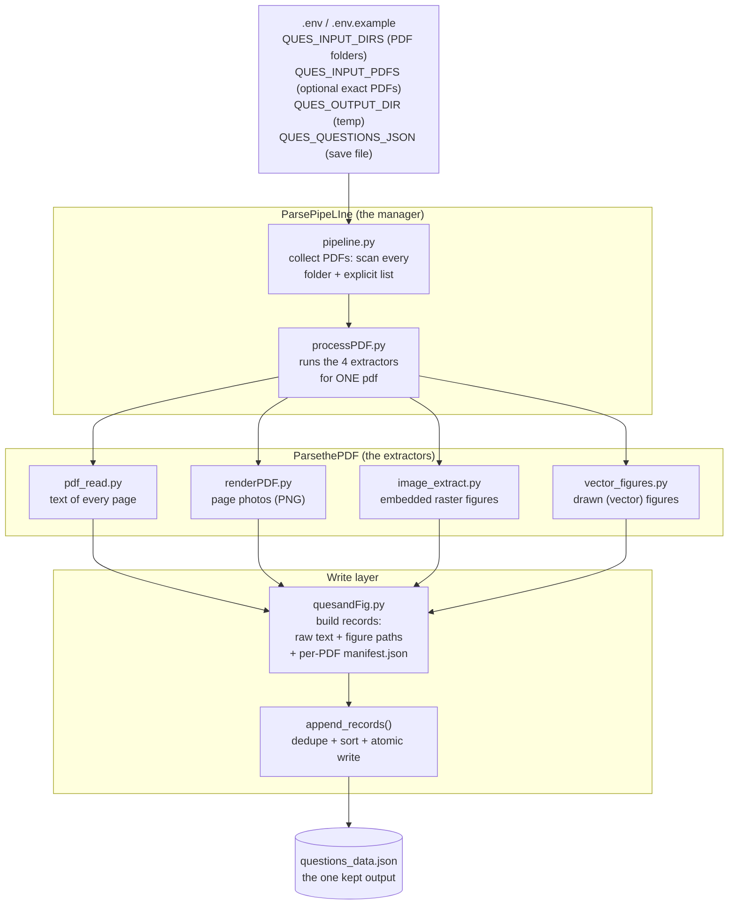
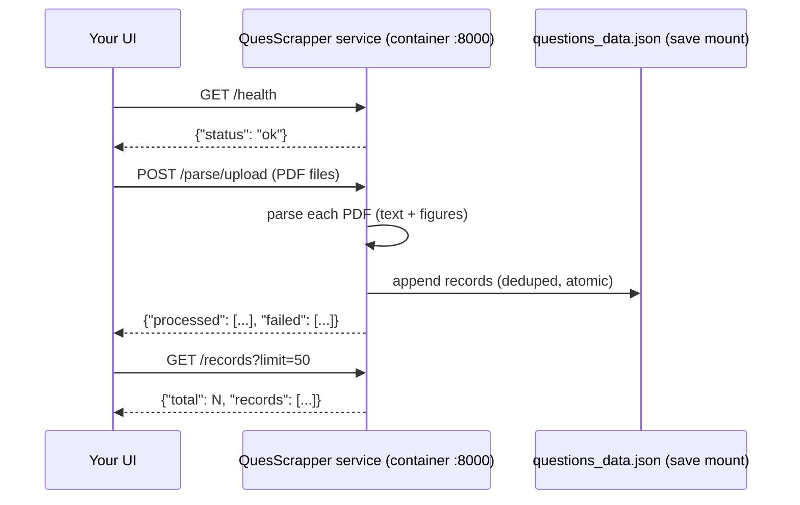

# QuesScrapper — Full Guide

Simple, step-by-step documentation. Read this top to bottom and you will know what the tool does, how to run it, and what it gives you.

---

## 1. What is this tool for?

You have exam **question papers as PDF files**. This tool:

1. Opens each PDF.
2. **Scrapes** every page: all the **raw text** and all the **figures** (pictures inside the PDF, and diagrams drawn with lines/boxes).
3. **Appends** the result into **one JSON file** named `questions_data.json`.

That's it. This is the only job it has right now:

- It does **NOT** sort text into individual questions yet.
- It does **NOT** do OCR on scanned pages yet (that comes in a later phase).
- Everything it collects is **raw** — plain text as-is and figure images as-is.

---

## 2. How does it work? (step by step)

For every PDF in the input folder, the pipeline does 5 steps:

| Step | What happens | Where it is saved |
|---|---|---|
| 1 | Reads the text of each page (the text that is already inside the PDF) | `text/page_0001.txt` + inside the JSON |
| 2 | Makes a normal photo of each page (a PNG, 250 DPI) | `pages/page_0001.png` |
| 3 | Pulls out every **picture** embedded in the page (an image stored inside the PDF) | `images/page_0001_image_1.jpeg` |
| 4 | Pulls out every **drawn figure** (line/box diagrams that are not pictures — the tool photographs just that area) | `images_vector/page_0001_drawing_1.png` |
| 5 | Writes **one line (record) per page** into the shared JSON file | `<save path>/questions_data.json` |

Steps 1–4 are per page and saved in a folder named after the PDF, so two PDFs never overwrite each other's files.

### The whole flow as a picture (mermaid)

GitHub/GitLab render this diagram automatically. Roughly: the `.env` file decides **what to read** (folders and/or specific PDFs) and **where to append**; the pipeline works through the PDFs one by one; every produced record is appended into the one dataset JSON.



What happens on a failure: if one PDF is broken, it is reported and skipped — the others still run. If the dataset file is unreadable, it is backed up as `.bak` and a fresh file starts.

### What one record in the JSON looks like

```json
{
  "pdf_name": "AI363 INTRODUCTION TO MACHINE LEARNING_MID.pdf",
  "page_number": 1,
  "raw_text": "BIRLA INSTITUTE OF TECHNOLOGY, MESRA, RANCHI ...",
  "text_character_count": 1596,
  "figure_paths": ["...images/page_0001_image_1.jpeg", "...images_vector/page_0001_drawing_1.png"],
  "page_image": ".../pages/page_0001.png",
  "needs_ocr_review": false
}
```

- `raw_text`: the whole page text, exactly as scraped.
- `figure_paths`: the figure image files for this page (only listed here — not inside the JSON, they stay as image files next to it).
- `needs_ocr_review`: `true` when a page has almost no text (< 20 chars) — a hint that the page might be scanned and may need OCR later.

### Why JSON (and not CSV)?

The figures are image files and a page can have many of them. In JSON, a page = one record with a list of figure paths — clean and simple. In CSV you would have to squash that list into one cell. If CSV is ever needed, it can be exported from this JSON later.

### Re-running is safe

Records are keyed by (**pdf name + page number**). Run the tool again on the same PDFs:

- No duplicates. A re-run **replaces** the pages of that PDF.
- New PDFs just get **added** at the end.
- If the save file is ever unreadable/corrupt, a `.bak` backup is made and a fresh file starts.

---

## 3. How to use it (normal, on your computer)

You need Python 3.11+ and [uv](https://docs.astral.sh/uv/) installed.

**Step 1 — put your PDFs in the input folder.**
Default folder: `sampleData/ques_bank/`. Drop any number of PDFs there.

**Step 2 — install:**

```bash
uv sync
```

**Step 3 — run:**

```bash
uv run python -m ParsePipeLIne.pipeline
```

**Step 4 — check results:**
Open `sampleData/ques_bank/output/questions_data.json`. Done.

Important:
- Always run from the **project root folder**.
- Do NOT run `python ParsePipeLIne/pipeline.py` directly (it breaks imports — see `test.md`).

### Changing the paths: the .env file

All paths are configured in the **`.env`** file in the project root. `.env.example` is the template — copy it, rename to `.env`, and edit. All paths are **relative** (to the project root, or the container workdir) for security — no absolute machine paths are needed.

Lists are comma-separated. Real environment variables (shell / container) override `.env`.

| Variable | Default | Meaning |
|---|---|---|
| `QUES_INPUT_DIRS` | `sampleData/ques_bank` | **which PDF folder(s) to read.** Comma-separated `dir1, dir2` to scan several directories at once (searched recursively). |
| `QUES_INPUT_PDFS` | *(empty)* | **read ONLY these PDFs** — exact names/paths, comma-separated. When set, `QUES_INPUT_DIRS` is ignored and exactly the listed files are parsed. Leave empty to scan whole folders. |
| `QUES_OUTPUT_DIR` | `sampleData/ques_bank/output` | temp extraction folder (pages, images, text) — disposable, deleted freely |
| `QUES_QUESTIONS_JSON` | `.../questions_data.json` | **the JSON file to save/append into — the one output that matters** |

---

## 4. How to use it (Docker container)

The container has **two modes**:

- **HTTP service** (default) — for the **UI** to send requests (see section 5).
- **Batch CLI** — the one-shot run like the local command; add `cli` to the run command.

For the one-shot batch CLI version:

- **Input:** mount your folder with PDFs at `/data/input`.
- **Save path:** mount a folder at `/data/save` — the **only thing you need to keep** (`questions_data.json`) is written there.
- **Everything else is temporary:** page images, figures, text files go to `/tmp/qa_extraction`. The container can destroy that folder at any time — it is disposable. **Do not try to keep those files; keep the JSON file.**

Build the image once:

```bash
docker build -t quesscrapper .
```

Or run it with docker compose (same mounts, from the project root):

```bash
docker compose run --rm quesscrapper cli
```

Or run the container directly (batch mode):

```bash
docker run --rm \
  -v /path/to/your/pdfs:/data/input:ro \
  -v /path/to/where/you/want/the/json:/data/save \
  quesscrapper cli
```

What each line does:

- `--rm` — throw the container away after it finishes (temp outputs are thrown away with it, which is fine).
- Volume 1 — your PDFs go **in**.
- Volume 2 — your save folder. After the run it contains `questions_data.json` **and nothing else needs to survive**.

The container runs as a **non-root user with uid/gid 1000** (typical Linux host user), so the saved `questions_data.json` stays readable/writable for the host owner — no root files in your save folder.

The container picks paths from these env defaults (already set in the Dockerfile, overridable with `docker run -e ...` or via `env_file: .env` in compose, which is optional): `QUES_INPUT_DIRS=/data/input`, `QUES_QUESTIONS_JSON=/data/save/questions_data.json`, `QUES_OUTPUT_DIR=/tmp/qa_extraction`.

FAQ you may be thinking about:

- **"The images and text files are lost after each run — is that okay?"** Yes. They are generic/duplicate copies of what's already in the JSON record (the JSON lists the figure paths). Keep the JSON; re-run a PDF any time to regenerate the files.
- **"Many PDFs at once?"** Yes — put all of them in the input folder. One broken PDF gets skipped with a printed error; the rest still run.

---

## 5. How to use it (HTTP service — for the UI)

**No CLI is needed for the UI** — the container runs a small **FastAPI** HTTP service by default, and the UI simply sends requests to it (`docker run ... quesscrapper` / `docker compose up` starts it on port 8000).

Flow: **UI → POST PDF → service parses → dataset JSON grows → UI reads records back.**



### The endpoints

| Method | Endpoint | What it does |
|---|---|---|
| GET | `/health` | liveness check for the UI |
| POST | `/parse/upload` | **UI sends PDF files** (multipart, field name `files`); each is parsed and appended; broken files reported in the response |
| POST | `/parse` | parse by paths inside the container (`{"dirs": [...], "pdfs": [...]}`); body optional — falls back to the mounted folders / `.env` selection |
| GET | `/records` | **UI reads the data**: `{"total": n, "records": [...]}` with optional `?limit=&offset=` |

Interactive docs (try it in the browser, auto-generated): `http://localhost:8000/docs`

### Starting it

```bash
docker compose up            # from the project root (needs ./data/input and ./data/save folders to exist)
# or directly:
docker run -d -p 8000:8000 \
  -v /path/to/your/pdfs:/data/input:ro \
  -v /path/to/where/you/want/the/json:/data/save \
  --name quesscrapper quesscrapper
```

### Trying it from the command line (what the UI would do)

```bash
curl http://localhost:8000/health

curl -X POST http://localhost:8000/parse/upload \
  -F "files=@paper1.pdf" -F "files=@paper2.pdf"

curl "http://localhost:8000/records?limit=5"
```

Notes:

- Saves go to `QUES_QUESTIONS_JSON` (default `/data/save/questions_data.json` in the container). Same dedupe/upsert rules as every other run — a PDF sent twice is updated once.
- Uploads and extraction artifacts are request-local temp files that are deleted afterwards; only the dataset JSON grows.
- UID/GID 1000 note from section 4 applies to any file the service writes into the save mount.

### What the UI sends, what happens

**A list of files `[file1, file2, file3]`** — send them all in one request; the `files` field is repeatable. All three get parsed and appended in that single call:

```bash
curl -X POST http://localhost:8000/parse/upload \
  -F "files=@file1.pdf" -F "files=@file2.pdf" -F "files=@file3.pdf"
```

```json
{"processed": [{"pdf_name": "file1.pdf", "pages": 2},
               {"pdf_name": "file2.pdf", "pages": 1},
               {"pdf_name": "file3.pdf", "pages": 4}],
 "failed":   [{"file": "not_a_pdf.txt", "error": "not a .pdf file"}]}
```

- Every entry is reported per file: parsed files under `processed` (with page counts), broken/non-PDF entries under `failed`. One bad file never blocks the others.
- Sending a file again (same request or later) does **not** duplicate anything — its records are replaced (dedupe by pdf name + page number).

**A list of folders from the UI** — put them in a `POST /parse` request; each folder is scanned for PDFs and everything found is parsed and appended:

```bash
curl -X POST http://localhost:8000/parse \
  -H "Content-Type: application/json" \
  -d '{"dirs": ["folder/one", "folder/two"]}'
```

- Send `"pdfs": [...]` instead to read **only** those exact files (same precedence as `QUES_INPUT_PDFS` in `.env`).
- Sending no body falls back to the default selection: the mounted folders (or the `.env` `QUES_INPUT_DIRS` / `QUES_INPUT_PDFS`).

---

## 6. Tests

```bash
uv run pytest test/ -v
```

The tests make their own tiny PDFs (with text, an image, and a drawn diagram) — they don't need any sample files. They check all 5 steps, the safe re-run behavior, the HTTP endpoints, and that one bad PDF doesn't stop the batch. Also runs automatically on GitHub via `.github/workflows/tests.yml`.

---

## 7. What is coming in later phases (not yet)

1. **OCR** — scanned pages (`needs_ocr_review: true`) will be read by [PaddleOCR](https://github.com/PaddlePaddle/PaddleOCR). It needs an NVIDIA GPU (CUDA). It is already prepared — install with `uv sync --extra ocr` — but not wired into the pipeline yet.
2. **Question splitting** — arranging raw pages into individual questions and their figures.
3. **Word export** — making the final document from the arranged questions.

---

## 8. Folder map (what every file is)

```
├── .env / .env.example        # YOUR editable settings: which PDFs to read, where to save
├── config.py                  # reads .env + applies the defaults
├── main.py                    # same as the batch command, e.g. `uv run python main.py`
├── Dockerfile                 # makes the container (sections 4–5; HTTP service + CLI)
├── .dockerignore              # files the container image should skip
├── .github/workflows/tests.yml # runs the tests automatically on GitHub
├── pyproject.toml / uv.lock   # project name, dependencies, locked versions
├── ParsethePDF/               # the extraction library (each file = one job)
│   ├── pdf_read.py            #   step 1: read page text
│   ├── renderPDF.py           #   step 2: photo each page
│   ├── image_extract.py       #   step 3: pull out embedded images
│   ├── vector_figures.py      #   step 4: pull out drawn diagrams
│   ├── manifest.py            #   saves a per-PDF report (manifest.json)
│   └── ocr.py                 #   (later step: OCR — not connected yet)
├── ParsePipeLIne/             # the manager layer
│   ├── processPDF.py          #   runs steps 1–5 + manifest for ONE pdf
│   ├── quesandFig.py          #   builds records + appends into the JSON
│   ├── pipeline.py            #   batch mode: loops over ALL pdfs in the input folders
│   └── service.py             #   HTTP service mode: /health /parse/upload /parse /records (FastAPI)
├── test/                      # the tests (see section 6)
│   ├── helpers.py             #   makes tiny test PDFs
│   ├── test_pdf_read.py, test_image_extract.py, test_vector_figures.py,
│   ├── test_quesandFig.py, test_pipeline.py, test_service.py
│   └── PDFingestion.py        #   old hand-written prototype (kept for history)
└── sampleData/ques_bank/      # sample question papers (your PDFs go here too)
```

The small working notes `ques.md` (PDF sources) and `test.md` (the run-command gotcha) are kept on purpose.
