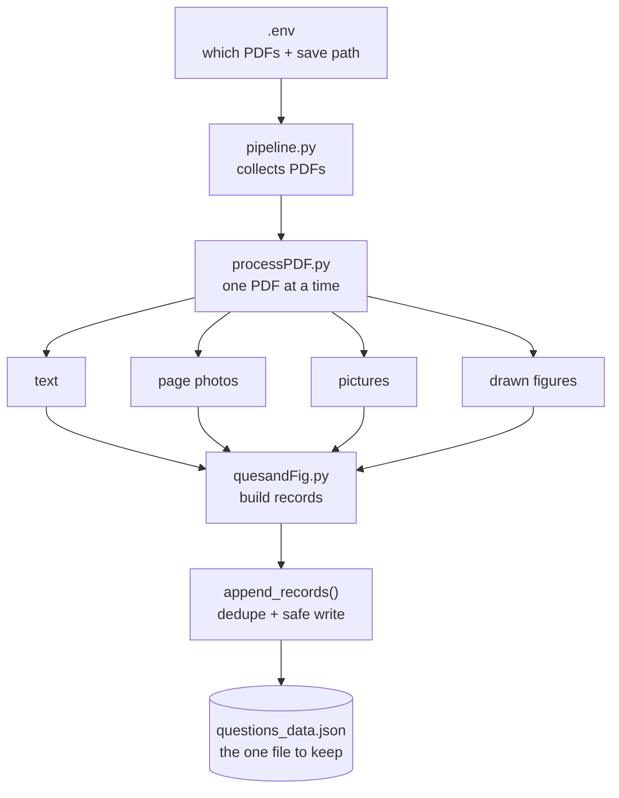
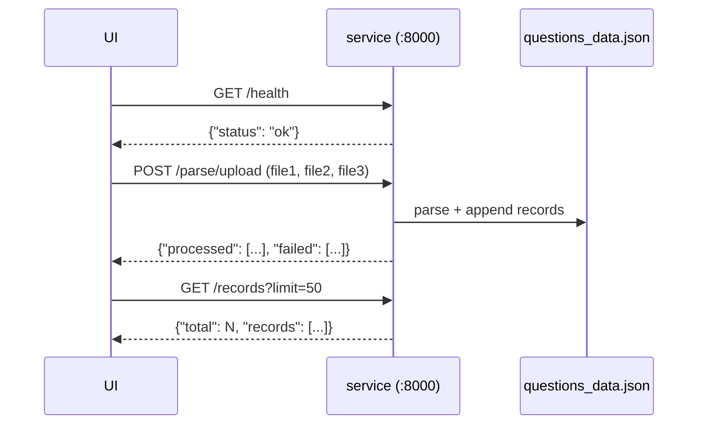

# QuesScrapper — Full Guide

Plain steps. Read top to bottom and you know everything.

---

## 1. What does it do?

It parses exam question-paper PDFs:

1. Opens each PDF.
2. Scrapes every page — **raw text** + **figures** (embedded pictures and drawn diagrams).
3. Appends the result into **one JSON file**: `questions_data.json`.

Not yet (later phases): question splitting, OCR, Word export.

---

## 2. How does it work?

**5 steps for every PDF:**

| Step | What happens | Where it is saved |
|---|---|---|
| 1 | Reads each page's text | `text/page_0001.txt` + JSON |
| 2 | Photo of each page (PNG, 250 DPI) | `pages/page_0001.png` |
| 3 | Pulls out embedded **pictures** | `images/page_0001_image_1.jpeg` |
| 4 | Pulls out **drawn figures** | `images_vector/page_0001_drawing_1.png` |
| 5 | Writes **one record per page** into the shared JSON | `questions_data.json` |



One broken PDF is skipped and reported — the others keep running. A corrupt save file is backed up as `.bak`.

**One record = one page:**

```json
{
  "pdf_name": "AI363 ... LEARNING_MID.pdf",
  "page_number": 1,
  "raw_text": "BIRLA INSTITUTE OF TECHNOLOGY ...",
  "figure_paths": ["...images/page_0001_image_1.jpeg", "...images_vector/page_0001_drawing_1.png"],
  "needs_ocr_review": false
}
```

`needs_ocr_review: true` → page has almost no text → probably scanned → OCR candidate later.

**Why JSON?** A page can hold many figure files — JSON keeps that as a clean list. CSV has no clean place for it.

**Re-running is safe.** Records are keyed by *pdf name + page number*: same PDF replaces, new PDFs add. No duplicates — ever.

---

## 3. Run on your computer

1. Drop PDFs in the input folder (see `.env` below).
2. `uv sync`
3. `uv run python -m ParsePipeLIne.pipeline`
4. Open `questions_data.json`.

Always run from the **project root** — see `test.md`.

### The .env file (your settings)

Copy `.env.example` → `.env` → edit. Paths are relative, comma-separated lists. Real env vars override `.env`.

| Variable | Default | Meaning |
|---|---|---|
| `QUES_INPUT_DIRS` | `sampleData/ques_bank` | PDF folder(s) to read (comma = several, scanned recursively) |
| `QUES_INPUT_PDFS` | *(empty)* | read ONLY these exact PDFs (folders ignored when set) |
| `QUES_OUTPUT_DIR` | `sampleData/ques_bank/output` | temp folder (pages, images, text) — disposable |
| `QUES_QUESTIONS_JSON` | `.../questions_data.json` | **the JSON file to append into — keep this one** |

---

## 4. Run as a container (batch CLI)

One run = parse the PDFs, write the JSON, exit.

```bash
docker run --rm \
  -v /path/to/pdfs:/data/input:ro \
  -v /path/to/save:/data/save \
  quesscrapper cli
```

- PDFs go in at `/data/input`, the JSON comes out at `/data/save`.
- **Only the JSON survives.** Pages/images/text go to `/tmp` in the container and are thrown away.
- The container user has uid 1000, so the saved JSON stays owned by you.

---

## 5. Run as a container (HTTP service — for the UI)

Default mode: the container starts a small **FastAPI** service on port 8000.

**UI → send PDFs → service parses → JSON grows → UI reads back:**



| Method | Endpoint | What it does |
|---|---|---|
| GET | `/health` | is the service up |
| POST | `/parse/upload` | UI sends files (repeat `files=@...` for a list) |
| POST | `/parse` | parse mounted paths; no body = use the default selection |
| GET | `/records` | read the data (`?limit=&offset=`) |

Start it:

```bash
docker run -d -p 8000:8000 \
  -v /path/to/pdfs:/data/input:ro \
  -v /path/to/save:/data/save \
  quesscrapper
```

Try it:

```bash
curl http://localhost:8000/health
curl -X POST http://localhost:8000/parse/upload \
  -F "files=@file1.pdf" -F "files=@file2.pdf" -F "files=@file3.pdf"
curl "http://localhost:8000/records?limit=5"
```

Browser docs: `http://localhost:8000/docs`

**UI sends a list of files** → all parsed in that one request; `processed` holds per-file page counts, `failed` holds broken/non-PDF entries; the good files always go through. Sending the same file again replaces its records — no duplicates.

**UI sends a list of folders** → `POST /parse` with `{"dirs": ["folder/one", "folder/two"]}`. Send `{"pdfs": [...]}` instead to read only those exact files.

---

## 6. Tests

```bash
uv run pytest test/ -v
```

They build their own tiny PDFs (text, image, drawn diagram) — no sample files needed. They cover all 5 steps, re-run safety, the HTTP endpoints, and broken-PDF isolation. GitHub runs them automatically (`.github/workflows/tests.yml`).

---

## 7. Later phases (not yet)

1. **OCR** — scanned pages (`needs_ocr_review: true`) via [PaddleOCR](https://github.com/PaddlePaddle/PaddleOCR). Needs an NVIDIA GPU (CUDA). Prepared: `uv sync --extra ocr` — not wired in yet.
2. **Question splitting** — one record per question + its figures.
3. **Word export.**

---

## 8. What each file is

| File | Job |
|---|---|
| `.env` / `.env.example` | your settings — which PDFs, where to save |
| `config.py` | reads `.env`, applies defaults |
| `ParsethePDF/` | extractors: `pdf_read` (text), `renderPDF` (photos), `image_extract` (pictures), `vector_figures` (drawn), `manifest` (report), `ocr` (not connected yet) |
| `ParsePipeLIne/pipeline.py` | batch mode — ALL PDFs → JSON |
| `ParsePipeLIne/service.py` | HTTP mode — `/health` `/parse/upload` `/parse` `/records` |
| `ParsePipeLIne/processPDF.py`, `quesandFig.py` | parse one PDF / build + append records |
| `test/` | tests (see section 6) |
| `sampleData/ques_bank/` | sample PDFs — drop yours here too |

Working notes kept on purpose: `ques.md` (PDF sources), `test.md` (run-command gotcha).
