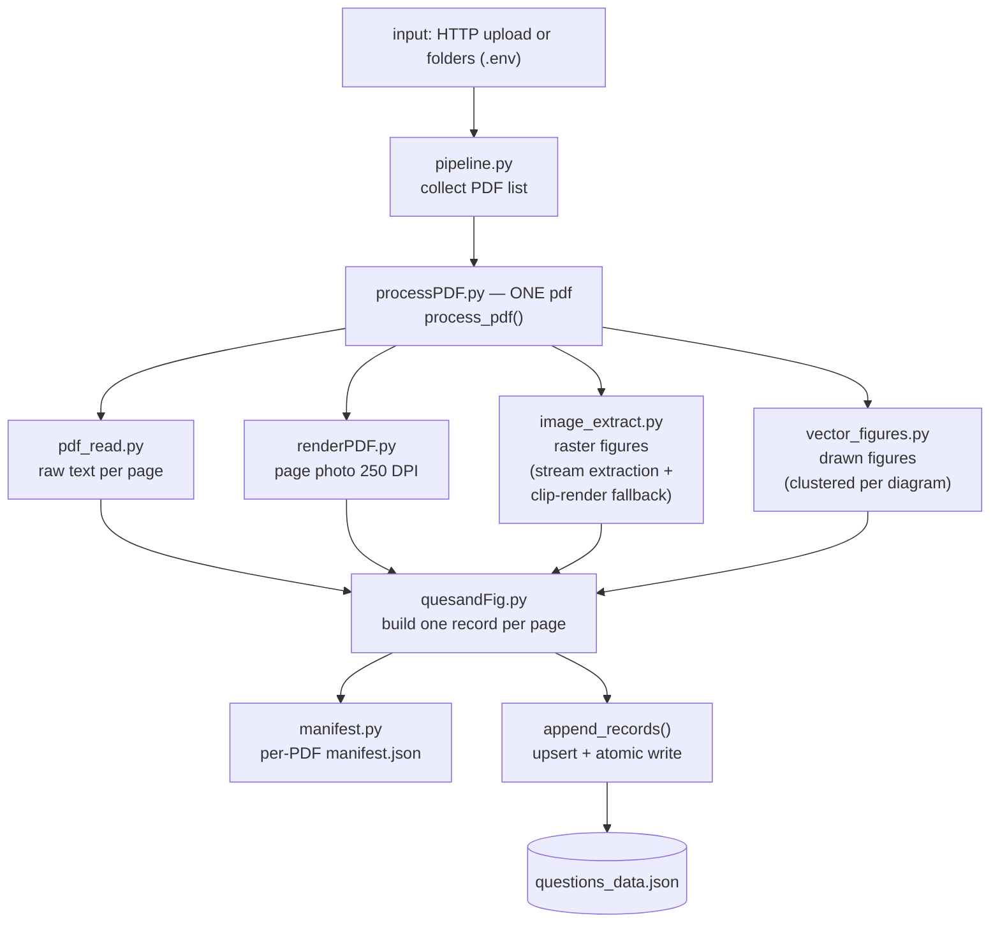

# QuesScrapper — Integration & Pipeline Reference

For developers of **other services and orchestrators** that want to run, feed, or extend this tool. Read `README.md` for the 1-minute overview first; this file is the contract.

---

## 1. What this service is (one paragraph)

A stateless-ish parser: it takes question-paper PDFs (uploaded over HTTP or read from mounted folders), scrapes **raw text** and **figure images** per page, and **appends** the result into one JSON dataset file. It does no question splitting and no OCR (yet). Everything it produces beyond the JSON is disposable temp data.

---

## 2. The two run modes (same engine underneath)

| Mode | Start command | Behavior | Use it for |
|---|---|---|---|
| **HTTP service** | `docker run -d -p 8000:8000 ... quesscrapper` or `uv run python -m ParsePipeLIne.service` | Long-running FastAPI server on port 8000 (override: `QUES_PORT`) | A UI / orchestrator sending requests |
| **Batch CLI** | `docker run ... quesscrapper cli` or `uv run python -m ParsePipeLIne.pipeline` | One shot: parse configured input, write JSON, exit: `0` all OK, `1` if some/all PDFs failed or none found | Cron jobs, schedulers, Airflow-style tasks |

The dispatcher lives in `ParsePipeLIne/service.py::main()`: argument `cli`/`batch` → batch mode, anything else → HTTP service. Both modes call the same two functions:

- `ParsePipeLIne.processPDF.process_pdf(pdf_path, extraction_dir)` → `(records, manifest)` for ONE pdf
- `ParsePipeLIne.quesandFig.append_records(records, json_path)` → upsert into the dataset, returns total count

Any orchestrator can import/call exactly those two functions instead of using HTTP or the CLI.

---

## 3. Configuration contract

Precedence: **real environment variables > `.env` file > built-in defaults**. Paths are relative; comma-separated values build lists.

| Variable | Default | Meaning |
|---|---|---|
| `QUES_INPUT_DIRS` | `sampleData/ques_bank` | PDF folder(s) to scan **recursively** |
| `QUES_INPUT_PDFS` | *(empty)* | **Exclusive override** — when non-empty, ONLY these exact PDFs are read; the dir list is ignored |
| `QUES_OUTPUT_DIR` | `sampleData/ques_bank/output` | Temp extraction folder — safe to delete anytime |
| `QUES_QUESTIONS_JSON` | `.../output/questions_data.json` | The dataset file to append into (the only kept output) |
| `QUES_PORT` | `8000` | HTTP service port (service mode only) |

Container defaults: `QUES_INPUT_DIRS=/data/input`, `QUES_QUESTIONS_JSON=/data/save/questions_data.json`, `QUES_OUTPUT_DIR=/tmp/qa_extraction`, `QUES_PORT=8000`.

---

## 4. Dataset contract (what other services read)

`questions_data.json` is a **JSON array**, one object per PDF page:

```json
{
  "pdf_name": "AI24201 MATHEMATICS FOR AIML_MID.pdf",
  "page_number": 1,
  "raw_text": "…full page text exactly as scraped…",
  "text_character_count": 2940,
  "figure_paths": ["output/…met/images/page_0001_image_1.jpeg"],
  "page_image": "output/…/pages/page_0001.png",
  "needs_ocr_review": false
}
```

Rules your services can rely on:

- **Key = (`pdf_name`, `page_number`).** Re-parsing a PDF **replaces** its page records (upsert, no duplicates). New PDFs append at the end.
- **Writes are atomic** (temp file + rename). A concurrently reading service never sees a half-written file. If the dataset is corrupt, it is backed up as `*.bak` and a fresh file starts.
- **HTTP appends are serialized** behind a lock — parallel `POST /parse/upload` calls are safe.
- `needs_ocr_review: true` = page had < 20 text characters → likely a scanned page; treat as OCR candidate.
- `figure_paths` / `page_image` point to files that may be **temporary** (in the container they live in `/tmp` and die with it). If you need the images long-term, mount the output dir or copy them before the container exits — the paths inside the JSON stay relative to wherever the extractor was told to write (`QUES_OUTPUT_DIR`).

Scale note: the dataset is a plain JSON array — fine for thousands of pages, not millions. Big datasets → start splitting by `pdf_name` (extension point, section 7).

---

## 5. HTTP contract

Base: `http://<host>:8000`. Auto-generated interactive docs: `/docs` (OpenAPI at `/openapi.json`).

| Method | Endpoint | Request | Response |
|---|---|---|---|
| GET | `/health` | — | `{"status": "ok"}` (200) — use as readiness probe |
| POST | `/parse/upload` | multipart, field `files` repeated for a list | `{"processed": [{"pdf_name","pages"}…], "failed": [{"file","error"}…]}` (200). Per-file report; one bad file never blocks the others |
| POST | `/parse` | optional JSON body `{"dirs": [...], "pdfs": [...]}`; omitted fields fall back to config | same shape as upload (200). `404` if no PDFs found; `500` if all failed |
| GET | `/records` | `?limit=N&offset=M` (limit 0 = all) | `{"total": n, "records": [...]}` |

Semantics for callers:

- **Retries are safe.** Uploading the same PDF twice just replaces its records.
- **Order of `processed` = order of files sent.** Parse failures land in `failed` with the reason string.
- The parsing request is synchronous — a response means the records are already in the dataset.

---

## 6. Data flow (how one PDF becomes records)



Failure behavior: one broken/stub PDF is logged + skipped, the batch continues. Per-PDF stats land in `QUES_OUTPUT_DIR/<pdf_stem>/manifest.json`.

---

## 7. Extension points (how to build on it)

- **Add an extractor** (e.g. tables, handwriting): create a module in `ParsethePDF/` returning the same record shape (`page_number`, `image_path`, width/height), then call it from `processPDF.py` and merge into the record's `figure_paths`.
- **OCR phase**: `ParsethePDF/ocr.py` is the prepared stub (PaddleOCR, optional extra `uv sync --extra ocr`). Planned wiring: pages flagged `needs_ocr_review: true` get OCR'd and their `raw_text` upgraded in place (same upsert key).
- **Post-processing services**: read the dataset, do question splitting, write a NEW file — do **not** rewrite `questions_data.json` while a run is active (you would be overwritten by the next atomic append).
- **Splitting the dataset**: key is (`pdf_name`, `page_number`) — partition by `pdf_name` and the upsert logic still holds per file.
- **Scaling the service**: it is single-process and CPU-bound. Run multiple instances behind a load balancer ONLY with the same `QUES_QUESTIONS_JSON` on shared storage + the append lock (one process) or move to a queue-based worker model. Two instances appending to one file without coordination will lose records.
- **Different save backend**: everything funnels through `append_records()` + atomic file write in `quesandFig.py` — swap that one function to target S3/Postgres/whatever; both modes pick it up.

---

## 8. Container facts orchestrators care about

- Runs as **non-root user uid/gid 1000** — save mounts stay host-editable.
- **Only the dataset JSON needs a persistent mount** (`/data/save`). Input mount can be **read-only** (`/data/input:ro`); extraction artifacts go to `/tmp` by design.
- Batch exit code: `0` when every PDF parsed, `1` when some/all failed or none were found — usable in cron/orchestrator checks.
- Health probe: `GET /health`.

Per-PDF extraction lands in `QUES_OUTPUT_DIR/<pdf_stem>/` (`_stem` = PDF filename without extension): `text/`, `images/`, `images_vector/`, `pages/`, `manifest.json`.
