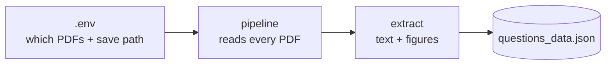

# QuesScrapper

Reads question-paper PDFs → saves each page's **text** and **figures** → appends it all into **one JSON file** (`questions_data.json`).

- Re-runs never duplicate — same PDF just gets updated.
- Today it **only parses**. No question splitting, no OCR yet.



## How to use

You need Python 3.11+ and [uv](https://docs.astral.sh/uv/).

1. Copy `.env.example` → save as `.env` → edit:
   - `QUES_INPUT_DIRS` — PDF folder(s) to read
   - `QUES_INPUT_PDFS` — optional: read ONLY these exact PDFs
   - `QUES_QUESTIONS_JSON` — the JSON file to save into
2. `uv sync` — install once
3. `uv run python -m ParsePipeLIne.pipeline` — run from the project root
4. Open `sampleData/ques_bank/output/questions_data.json`

## Docker

Batch (one run, one JSON):

```bash
docker run --rm \
  -v /path/to/pdfs:/data/input:ro \
  -v /path/to/save:/data/save \
  quesscrapper cli
```

Service (a UI sends requests to port 8000 — no CLI needed by the UI):

```bash
docker run -d -p 8000:8000 -v /path/to/save:/data/save quesscrapper
```

| Endpoint | Purpose |
|---|---|
| `GET /health` | is the service up |
| `POST /parse/upload` | UI sends PDF files (repeat `files=@...` for `[file1, file2, file3]` in one request) |
| `POST /parse` | parse mounted folders/files: `{"dirs": [...]}` or `{"pdfs": [...]}` |
| `GET /records` | UI reads the data back (`?limit=&offset=`) |

Try it in the browser: `http://localhost:8000/docs`. Broken files are reported under `failed` and never block the rest. Only the JSON file survives a container run — images/text are temporary.

Sample PDFs live in `sampleData/ques_bank/`. Sources: [BIT Mesra exam portal](https://bitmesra.ac.in/Other-Department-Pages/content/1/258/446).

## GPU?

Not needed. Everything today runs on CPU (`pymupdf`). CUDA is only required later, for the OCR phase (PaddleOCR). Full guide: **[DOCS.md](./DOCS.md)**.
